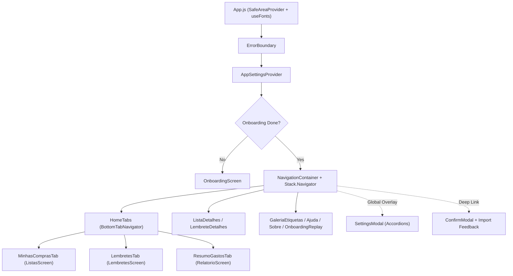

# Frontend Architecture & Design System Blueprint

> **Reference App:** Minha Lista de Compras (`v1.0.8`, Expo SDK 58 / React Native 0.88 / React 19.3)  
> **Companion Docs:** `@docs/DEV_MASTER_GUIDE.md`, `@docs/BACKEND_DATA_ARCHITECTURE.md`

---

## 1. Visual Stack & Core Layout Standards

| Package | Version | Role |
| :--- | :--- | :--- |
| `expo` | `^58.0.0` | Runtime, native plugins, build pipeline |
| `react` / `react-native` | `19.3.0` / `0.88.1` | Core UI framework (Android / iOS / Web) |
| `@react-navigation/native` / `stack` / `bottom-tabs` | `^7.x` | Navigation container, detail stack, fixed bottom tabs |
| `@expo/vector-icons` (`FontAwesome6`) | `^15.0.2` | Single standardized icon family (Regular, Solid, Brands) |
| `react-native-safe-area-context` | `~5.11.1` | Explicit safe-area insets (`useSafeAreaInsets`) |
| `react-native-gesture-handler` | `~3.3.0` | Native gesture support |
| `react-native-svg` | `15.16.0` | Bar & Pie charts (`src/pages/RelatorioScreen.js`) |
| `expo-camera` | `~58.0.14` | Live camera + barcode scanner (`CameraView`) |
| `expo-speech-recognition` | `^58.0.1` | Native `pt-BR` voice dictation for the product name field (lazy-loaded with Expo Go fallback) |
| `expo-font` / `expo-status-bar` | `~58.0.x` | Boot font preloading (`FontAwesome6.font`) & status bar |

### Layout Rules
- **Safe Area:** Every screen, header, bottom tab bar (`Math.max(7, insets.bottom)`), and full-screen modal (`Math.max(insets.top, Platform.OS === 'android' ? StatusBar.currentHeight || 24 : 12) + 8`) consumes `useSafeAreaInsets()`.
- **Responsive Wrapper:** `components/StyleSheet/Styles.js` defines `contentContainer: { width: '100%', maxWidth: 680, alignSelf: 'center' }`.
- **Lightweight Transitions:** Accordions/form toggles use `LayoutAnimation.configureNext(LayoutAnimation.Presets.easeInEaseOut)`.
- **Zero Icon Flicker:** `App.js` blocks navigation render until `useFonts({ ...FontAwesome6.font })` resolves.

---

## 2. Adaptive Multi-Theme System (`src/theme/themes.js` + `AppSettingsContext.js`)

Centralized in `src/theme/themes.js` and exposed via `useAppSettings()`.

### 2.1. Presets (8 Built-in + Custom Builder)

| ID (`THEME_IDS`) | Display Name (`pt-BR`) | Mode | Primary | Background | Card | Shape / Elevation |
| :--- | :--- | :--- | :--- | :--- | :--- | :--- |
| `light` | Claro Padrão | Light | `#15803D` | `#F8FAFC` | `#FFFFFF` | Soft (`14/12/10`, `1px`) |
| `dark` | Noturno Padrão | Dark | `#16A34A` | `#121212` | `#1E1E1E` | Soft (`14/12/10`, `1px`) |
| `amoled` | AMOLED Escuro | Dark | `#10B981` | `#000000` | `#121212` | Soft (`14/12/10`, `1px`) |
| `rose_quartz` | Rose Quartz | Light | `#D81B60` | `#FFF8FA` | `#FFFFFF` | Extra-rounded (`18/16/12`, `1px`) |
| `ocean_blue` | Azul Oceano | Light | `#1565C0` | `#F4F8FB` | `#FFFFFF` | Soft (`14/12/10`, `1px`) |
| `material_you` *(legacy alias: `google_maps`)* | **Material You** | Light | `#1A73E8` | `#F1F3F4` | `#FFFFFF` | Pill + Floating (`18/24/24`, shadow `elevation: 3`, `600` weight, `letterSpacing: 0.2`, `tabular-nums`, `#E8EAED` dividers) |
| `neon_matrix` | Neon Matrix | Dark | `#00C853` | `#050A06` | `#0B170E` | Sharp tech (`4/4/3`, `1.5px`) |
| `cyberpunk_neon` | Cyberpunk Neon | Dark | `#FF2A85` | `#0D0B1A` | `#161329` | Sharp tech (`4/4/3`, `1.5px`) |
| `custom` | Personalizado | Dynamic | 12 accents | Light/Dark/AMOLED | Dynamic | Square (`4`), Moderate (`12`), Rounded (`20`); `1px` or `1.5px` |

> **Backward Compatibility:** `normalizeThemeId()` in `src/theme/themes.js` transparently maps legacy `'google_maps'` keys stored in `AsyncStorage` to `THEME_IDS.MATERIAL_YOU` (`'material_you'`).

### 2.2. Semantic Tokens (`colors`, `shape`, `cardShadow`, `typography`)
- **Identity:** `primary`, `principal`, `primaryText`/`textoPrincipal` (auto-contrast via luminance `getContrastingTextColor()`), `accent`, `accentSoft`.
- **Surfaces:** `background`, `card`/`surface`, `surfaceMuted`, `inputBackground`, `dividerColor`.
- **Text & Borders:** `text`/`textoEscuro`, `textSecondary`/`textMuted`, `border`/`borderColor`, `disabledBackground`.
- **Feedback:** `success`, `verdeSuave`/`badgeBg`, `badgeText`, `warning`/`warningSoft`/`warningText`, `danger`/`logoutRed`/`dangerSoft`/`dangerText`, `budgetWarning*`, `budgetDanger*`.
- **Context Flags:** `radiusCard`, `radiusButton`, `radiusInput`, `borderWidth`, `cardShadow`, `typography`, `isMaterialYouTheme` (and legacy alias `isGoogleMapsTheme`).

---

## 3. Navigation & Screen Architecture (`App.js`)

---

## 4. Reusable Component Catalog

1. **List & Item Cards (`ListasScreen`, `ListaDetalhesScreen`, `LembreteDetalhesScreen`):**
   - `React.memo` rows with `useCallback` handlers, theme `cardShadow`, pill badges (`borderRadius: 999` on `Material You`), tabular-nums prices, and smart quantity stepper (`trash-can` when `qty <= 1`, `minus` when `qty > 1`).
2. **Accordion Settings (`SettingsModal.js`):**
   - Container `gap: 14`, `marginTop: 16` above `Concluir`, internal subsection cards with `gap: 12`, and **2×2 action grids** (`gap: 10`, `minHeight: 40`).
   - Includes **`Cadastro de Itens`** accordion with persisted default switch (`simplifiedItemForm`, default `true`), unified **`Câmera e Fotos das Etiquetas`** accordion (save photos, camera shutter sound, auto-delete retention days — mirrored identically in `OnboardingScreen.js`), and 4-subsection Diagnostics (`1. Ambiente & Versão (LGPD)`, `2. Testador de Consulta API (Câmera / EAN)`, `3. Exportação & Manutenção`, `4. Histórico de Eventos & Leituras`).
3. **Form & Confirmation Modals:**
   - `ItemFormModal.js`, `ListFormModal.js`: centered card (`maxWidth: 460`), inline validation, standardized `CancelButton` + `SaveButton`. `ItemFormModal.js` opens using the persisted `simplifiedItemForm` default (`true`) and includes a per-session header toggle pill **`Simplificado`** displaying only Name, Quantity, and Price while preserving inferred/API `category` and `unit` silently, plus a minimalist semi-translucent inline microphone button (`28x28`, `hitSlop={8}`, `position: 'absolute'`, `right: 10`, `paddingRight: 40` on input) **exclusively** inside the `Nome do produto` input.
   - `ConfirmModal.js`: supports optional `secondaryLabel` / `onSecondaryPress` (e.g., *"Fazer Backup Antes"*).
   - `ErrorBoundary.js`: catches render crashes, logs via `recordAppErrorLog`, renders recovery UI.
4. **Camera & Image Viewer (`CameraCaptureModal.js`, `TagPhotoPreviewModal.js`):**
   - **Expo SDK 58 Rule:** `<CameraView />` MUST be strictly self-closing (`<CameraView style={StyleSheet.absoluteFill} ... />`) inside `<View style={{ flex: 1, position: 'relative' }}>`; all overlays are `StyleSheet.absoluteFill` siblings with `pointerEvents="box-none"`.
   - Interactive `PanResponder` crop box (`48×48px` corner handles), `mute={!cameraSoundEnabled}`, and full-screen photo preview.

---

## 5. Domain Reuse Checklist

- **Copy verbatim:** `src/theme/themes.js`, `src/context/AppSettingsContext.js`, `components/common/ErrorBoundary.js`, `components/common/Buttons/`, `components/StyleSheet/`, `ConfirmModal.js`, `SettingsModal.js`, `OnboardingScreen.js`, `AjudaScreen.js`, `SobreScreen.js`.
- **Adapt to new domain:** Update `app.json`/`package.json`/`src/constants/appVersion.js` (`v1.0.0`), rename tabs in `App.js`, replace `GUIDANCE_CARDS` and `HELP_SECTIONS`.
